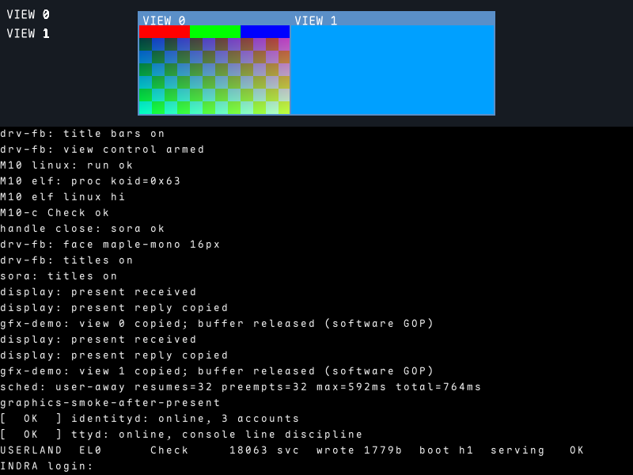
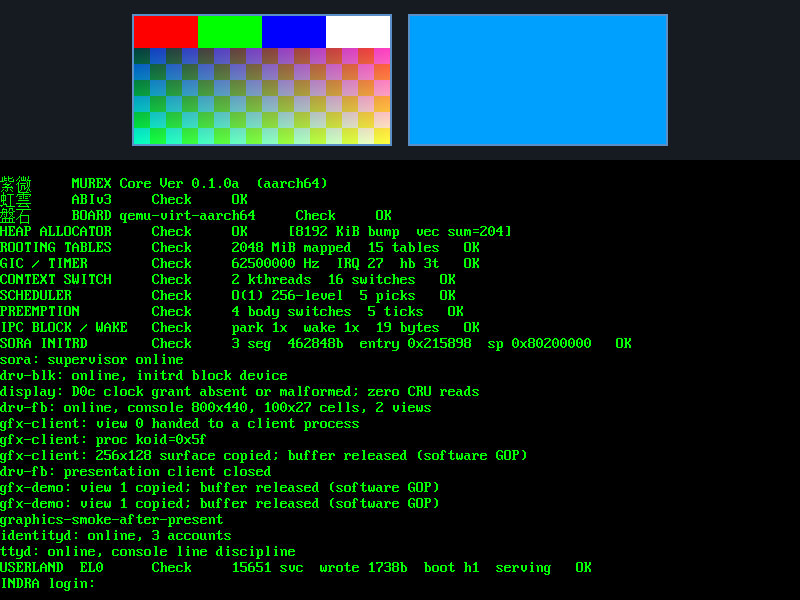
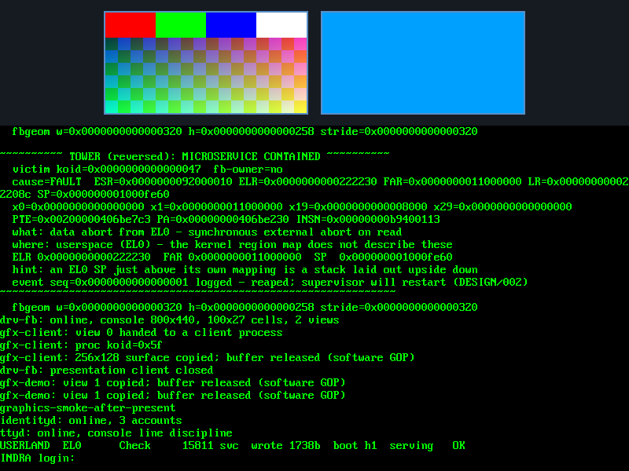
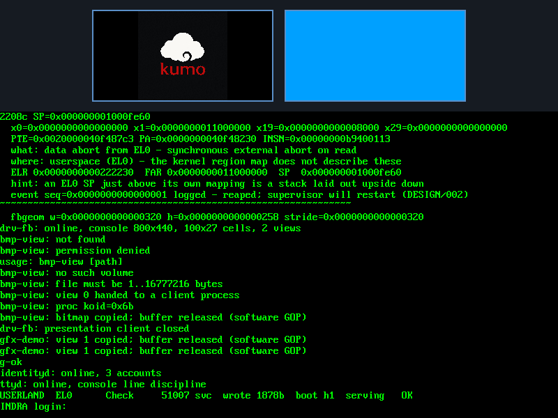
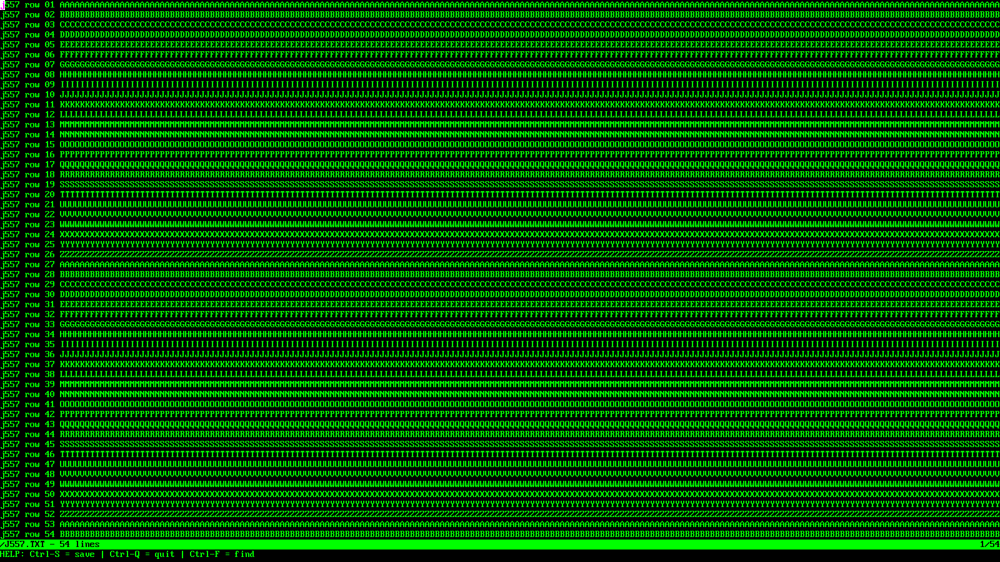

<!-- j764 -->

# KUMO gallery

[← Back to the project](README.md)

Screenshots and a terminal replay from KUMO's development. These show different stages
of the system, so console styling and diagnostics vary. The QEMU view captures use the
software GOP presentation path; they do not depict OpenGL or Vulkan rendering. Click
an image to open the original PNG.

## Titled views and the current console

A fresh UEFI boot in QEMU, with per-view title bars and the Maple Mono console face.
The graphics verification checks the view pixels, clipping, chrome, console text,
and arrival at login before capturing the framebuffer.

*QEMU · 800×600 · captured November 2, 2026 with `scripts/graphics-smoke.py --titles`.*

## Boot, views, and login

Two 256×128 views share the screen with the boot console. The left view contains a
client-rendered colour pattern; the right is a solid-blue demonstration surface.
Service startup continues below them to the INDRA login prompt.

*QEMU · 800×600 · supplied capture `pss1.png`.*

## A contained userspace fault

The TOWER diagnostic reports a fault in a userspace microservice. The kernel and the
remaining startup path continue: graphics, identity, and terminal services reach login.
This capture records an actual fault during bring-up.

*QEMU · 800×600 · supplied capture `pss2.png`.*

## An image as a userspace client

`bmp-view` loads a selected BMP through an explicit file grant, decodes it, and presents
it in a client surface. Here it displays the KUMO cloud and wordmark. The console also
shows file/path refusal checks from the same verification run.

*QEMU · 800×600 · bitmap-viewer verification capture.*

[Bitmap formats, file paths, and capability handoff →](userland/bmp-view/README.md)

## Kilo across the full terminal

The unmodified upstream Kilo C editor runs through KUMO's relibc and terminal services.
This replay fixture exercises a 200-column, 56-row terminal: document rows, status,
help, and cursor all fit the framebuffer instead of stopping at an 80×24 default.

*1600×900 · host framebuffer replay of terminal output captured from Kilo on Orange Pi.*

[How the Kilo port works →](userland/ports/kilo/README.md)
