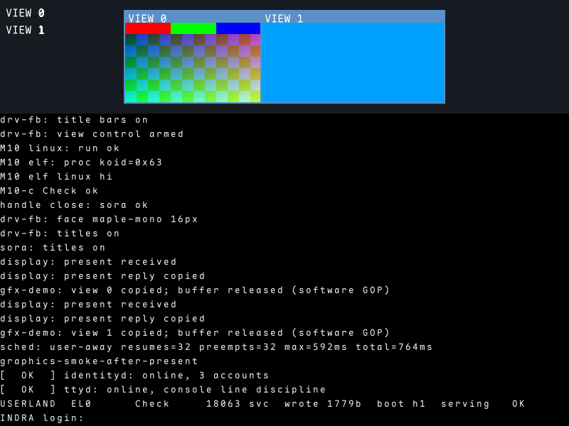

<!-- j764 -->
<!-- j768 -->
<!-- j769 -->
<!-- j904 -->
<!-- j906 -->

<p align="center">
  
</p>

<h1 align="center">KUMO (雲)</h1>
<p align="center"><strong>"Secure. Performant. Resilient."</strong></p>
<p align="center">
  <a href="#what-runs-today">Status</a> ·
  <a href="#build-and-run">Build &amp; run</a> ·
  <a href="GALLERY.md">Gallery</a> ·
  <a href="#inside-kumo">Architecture</a>
</p>

KUMO is an experimental operating system built around a `#![no_std]` Rust microkernel.
It takes inspiration from [soso](https://github.com/ozkl/soso), with a clean-room
implementation that moves drivers and system services into isolated userspace processes.
Authority travels through capability handles: a process receives the resources it is
granted, and services communicate through IPC.

The aim is a resilient, portable, UNIX-like environment with native Rust services,
C and C++ applications, persistent storage, and graphics. The system already reaches
an interactive login and shell on real hardware; it is still an early OS under active
development.

<p align="center">
  <a href="GALLERY.md"></a>
  <br />
  <sub>QEMU, November 2026: titled views, the Maple Mono console, and login. <a href="GALLERY.md">Explore the gallery →</a></sub>
</p>

## What runs today

*Status: November 2026. Hardware-specific progress is called out explicitly.*

| Area | Working paths |
|---|---|
| Kernel and IPC | Isolated address spaces, scheduling, capability handles and rights, channels, ports, timers, interrupts, and shared memory objects. |
| Userspace | Sora service supervision, identity and login services, the Kumoza shell, terminal line editing, and USB keyboard input. |
| Applications | Native Rust programs, relibc-backed C utilities, the unmodified Kilo editor, a Lua REPL, and a bitmap viewer. C++ runtime and TLS proofs also run. |
| Storage | Initrd files, writable FAT-backed scratch storage, and USB mass-storage/FAT32 access on Orange Pi. |
| Display | Software framebuffer views in QEMU; native HDMI at 1600×900 on Orange Pi, owned scanout buffers, vblank flips, cursor/input routing, and view title bars. |
| Mali-G610 | Native command submission and compute-to-display proofs on Orange Pi. Gallium clear/fence/readback and a static GLES2 client's renderer query and `glFinish` are proven on the GPU. |
| x86_64 | QEMU userspace, private address spaces, interrupt delivery, preemption, and per-thread x87/SSE/AVX state preservation. |

The Mesa work is progressing toward native OpenGL/GLES and Vulkan. A static GLES2 client
now creates a context with color/depth attachments, queries the Mali renderer, and completes
`glFinish` on hardware. The next GL gate is compute output and clear/readback through GL calls. A usable
GL/Vulkan application stack is still ahead. See the [Mesa integration notes](toolchain/mesa/README.md)
and [Mali compute kernels](shaders/mali/README.md).

Device access is capability-scoped. Live display-IOMMU ownership has been exercised on
RK3588, while GPU command streams currently follow a cooperative-client contract.
Full isolation from hostile GPU workloads remains unfinished.

Longer-term work includes a persistent RedoxFS root, a broader native Rust `std`
environment, and expanded application compatibility. The Linux persona currently covers
a limited static arm64 ELF path; syscall coverage grows as applications need it.

## Hardware

| Target | Architecture | Current role |
|---|---|---|
| **Orange Pi 5 Plus, 4 GB** | arm64 · Rockchip RK3588 | Active hardware platform: UEFI/PXE boot, serial login, USB input/storage, native HDMI, and Mali bring-up. |
| ThinkPad X13s Gen 1 | arm64 · Qualcomm SC8280XP | Established hardware boot and interactive-shell baseline. |
| Raspberry Pi 5 | arm64 · Broadcom BCM2712 | Earlier hardware bring-up; interrupt parity remains a secondary lane. |
| QEMU `virt` | arm64 | Automated boot, userspace, and framebuffer verification. |
| Intel NUC7i5DNHE | x86_64 · Core i5-7300U (Kaby Lake) | amd64 hardware rig, also a Fuchsia reference machine: PXE netboot via `run-pxehost.sh --target nuc`. |
| Generic UEFI PC / QEMU | x86_64 | Image builds and Multiboot/UEFI runtime smoke tests. |

Earlier x86 hardware boots include the HP Z4 G4 (Xeon W2123), HP Z650 (Xeon E5-2620),
and ThinkPad X220 (Core i7-2640M). Features vary by board; current RK3588 graphics
progress does not imply the same driver coverage on every target.

The reference Orange Pi uses the full RK3588 and board-specific SPI UEFI firmware.
Its debug UART is a 3.3 V DW-APB/16550-family UART at **1,500,000 baud**. KUMO stages
the OS payload; board firmware installation is a separate step.

## Build and run

Development currently uses an Apple Silicon host and the stable Rust toolchain selected
by [rust-toolchain.toml](rust-toolchain.toml). Image builds also use Python 3, Clang/LLD,
and the [relibc SDK overlay](toolchain/relibc/README.md). Initialize the relibc submodule
before the first build:

```sh
git submodule update --init --recursive vendor/relibc
rustup target add aarch64-unknown-none aarch64-unknown-uefi

# Stage an arm64 QEMU UEFI payload.
cargo xtask image --arch aarch64 --hardware qemu-virt-aarch64

# Run the serial kernel/userspace smoke (requires qemu-system-aarch64).
cargo xtask qemu-smoke --arch aarch64
```

The smoke should finish with:

```text
KUMO QEMU smoke green: READY reached, serial echo worked, Delete erased
```

Image output goes to `build/images/<hardware>/`: EFI loader, kernel, initrd, and any
board-specific DTB. This is a staged ESP payload tree. Installing it on physical media
and supplying the board's UEFI firmware are separate from `xtask image`.

Other targets:

```sh
cargo xtask image --arch aarch64 --hardware orange-pi-5-plus
cargo xtask image --arch aarch64 --hardware thinkpad-x13s-gen1

rustup target add x86_64-unknown-none x86_64-unknown-uefi
cargo xtask image --arch x86_64 --hardware generic-uefi-x86_64
cargo xtask x86-smoke
cargo xtask x86-uefi-smoke
```

The x86 smoke paths use `qemu-system-x86_64`; the UEFI path also requires OVMF and
GRUB tooling. Core host checks and contributor preflight:

```sh
cargo fmt --check
cargo test -p kernel
cargo test -p kumo-abi
./scripts/preflight.sh
```

To reclaim local disk space, preview rebuildable caches with
`python3 scripts/cleanup.py --worktrees`. Add `--apply` to remove them, or `--cargo`
for broader compilation-cache cleanup. Source, reference materials, worktrees,
sysroots and build evidence are preserved. See [local cleanup](docs/cleanup.md).

### Netbooting hardware

Physical rigs boot over the LAN: `scripts/run-pxehost.sh` builds one hardware target,
stages it as the TFTP tree `netboot/tftp/`, and serves it with a proxyDHCP/TFTP server
(a small [pxehost](https://github.com/pxehost/pxehost) overlay, built on first use).
Your existing router keeps handing out addresses; stop any other DHCP/TFTP service on
the host first. It listens on UDP 67, 69 and 4011; building the overlay needs Go.

```sh
./scripts/run-pxehost.sh                 # Orange Pi 5 Plus (the default target)
./scripts/run-pxehost.sh --target nuc    # Intel NUC7i5DNHE / any x86-64 PXE client
./scripts/run-pxehost.sh --target all    # serve both from one tree
./scripts/run-pxehost.sh --no-build      # restage the last build without rebuilding
```

| Target | Builds | Client sees (DHCP option 93) |
|---|---|---|
| `opi5` (default) | `cargo xtask image --arch aarch64 --hardware opi5plus` | arm64 UEFI (0x000b) → `bootaa64.efi` = Nijigumo, which fetches `EFI/KUMO/*` |
| `nuc` | `cargo xtask image --arch x86_64 --hardware generic-uefi-x86_64` at console level 7, plus GRUB i386-pc when installed | x86-64 UEFI (0x0007/0x0009) → `bootx64.efi` = Nijigumo, which fetches `amd64/EFI/KUMO/*` and puts first light on the screen; legacy BIOS (0x0000) → `core.0` = GRUB → Multiboot2 KUMO (serial only) |
| `all` | both | both |

**The tree only carries the selected target.** A refresh replaces `netboot/tftp/`
entirely, so after `--target opi5` there is no x86 loader in it: a NUC set to PXE-boot
first fails the TFTP fetch (`open .../bootx64.efi: no such file`) and falls through to
its disk (Fedora on the reference rig) rather than booting a stale KUMO from an earlier
build; `run-pxehost.sh` says `nuc: NOT SERVED` when that will happen. The two boards'
payloads never collide in an `all` tree: the Orange Pi's Nijigumo reads `EFI/KUMO/*` at
the root, the x86 Nijigumo reads `amd64/EFI/KUMO/*`. Every run prints the target it
staged, and `netboot/tftp/BUILD-INFO.txt` records it with the source commit. Set
`KUMO_PXE_TARGET` to change the no-argument default for your shell, and `KUMO_PXE_IP`
when the advertised address is detected wrongly. To restage without serving, call
`scripts/refresh-netboot.sh --target <t>` directly.

Target notes:

- **Orange Pi 5 Plus**: EDK2 SPI firmware with network boot enabled; console on the
  1,500,000-baud debug UART. After the first boot, typing `reboot` at the shell
  re-fetches the freshly staged tree.
- **NUC7i5DNHE**: disable Secure Boot, enable network boot (UEFI PXE on the onboard
  Intel NIC) in the firmware setup, and put it ahead of the SSD when testing KUMO.
  Nijigumo prints its own progress (GOP mode, kernel placement, TFTP fetches) on screen,
  then KUMO draws its console on the same screen, write-combined, and mirrors it to COM1
  at 115200 baud for when a serial header is wired up. The kernel is built at
  `KUMO_CONSOLE_LOGLEVEL=7` unless you set another level, because the screen shows only
  lines at or above it. Legacy BIOS PXE needs `i686-elf-grub` from Homebrew; without it
  the tree is UEFI-only.
- **Without the hardware**: `scripts/netboot-smoke.sh --uefi` netboots the staged tree in
  QEMU the way the NUC does (OVMF's own PXE → Nijigumo → KUMO) and saves the screen;
  `scripts/netboot-smoke.sh` does the legacy BIOS path.

## Inside KUMO

| Component | Responsibility | Source |
|---|---|---|
| **Nijigumo** | UEFI loader, staged assets, and the `BootInfo` handoff. | [boot/](boot/) |
| **MUREX** | Privileged mechanisms: scheduling, address spaces, capabilities, IPC, and traps. | [kernel/](kernel/) |
| **Sora** | First userspace process, capability grants, and service supervision. | [userland/sora/](userland/sora/) |
| **Kumoza and services** | Interactive sessions, terminals, identity, filesystems, and drivers. | [userland/](userland/) |
| **Shared ABI and HAL** | Kernel/userspace interfaces and architecture/board abstractions. | [lib/](lib/) · [hal/](hal/) |
| **Toolchain** | relibc, C/C++ support, and native Mesa integration. | [toolchain/](toolchain/) |

The architectural rule is simple: privileged code supplies mechanisms; userspace services
own policy. Drivers receive explicit device resources, and applications receive channels
and memory grants rather than framebuffer or device authority.

For a closer look, start with the [screenshots](GALLERY.md), [Kilo port](userland/ports/kilo/README.md),
[bitmap viewer](userland/bmp-view/README.md), and [GPU firmware provenance](firmware/README.md).

## Thanks

KUMO owes much to ozkl and the contributors to **soso**, and to the ideas and experience
shared by [motor-os](https://github.com/moturus/motor-os), Fuchsia/Zircon, XNU/Mach,
Redox OS, and seL4. Redox's relibc and RedoxFS work is particularly valuable to the
userspace and storage effort. The hope is to build something portable, purposeful,
and resilient in the face of failure.
