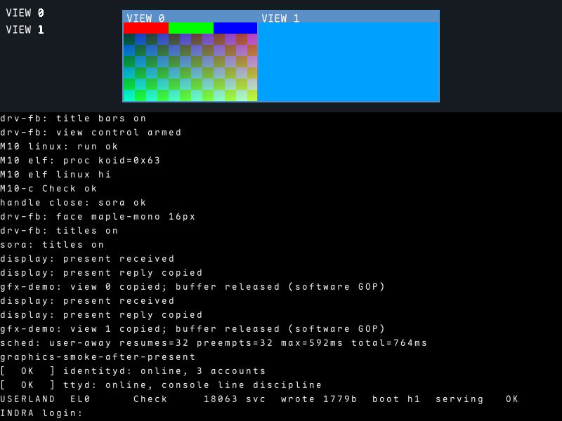

<!-- j458 -->
<!-- j764 -->

<p align="center">
  
</p>

<h1 align="center">KUMO (雲)</h1>
<p align="center"><strong>A serene, capability-based microkernel in Rust.</strong></p>
<p align="center">
  <a href="#what-runs-today">Status</a> ·
  <a href="#build-and-run">Build &amp; run</a> ·
  <a href="GALLERY.md">Gallery</a> ·
  <a href="#inside-kumo">Architecture</a>
</p>

KUMO is an experimental operating system built around a `#![no_std]` Rust microkernel.
It takes inspiration from [soso](https://github.com/ozkl/soso), with a clean-room
implementation that moves drivers and system services into isolated userspace processes.
Authority travels through capability handles: a process receives the resources it is
granted, and services communicate through IPC.

The aim is a resilient, portable, UNIX-like environment with native Rust services,
C and C++ applications, persistent storage, and graphics. The system already reaches
an interactive login and shell on real hardware; it is still an early OS under active
development.

<p align="center">
  <a href="GALLERY.md"></a>
  <br />
  <sub>QEMU, November 2026: titled views, the Maple Mono console, and login. <a href="GALLERY.md">Explore the gallery →</a></sub>
</p>

## What runs today

*Status: November 2026. Hardware-specific progress is called out explicitly.*

| Area | Working paths |
|---|---|
| Kernel and IPC | Isolated address spaces, scheduling, capability handles and rights, channels, ports, timers, interrupts, and shared memory objects. |
| Userspace | Sora service supervision, identity and login services, the Kumoza shell, terminal line editing, and USB keyboard input. |
| Applications | Native Rust programs, relibc-backed C utilities, the unmodified Kilo editor, a Lua REPL, and a bitmap viewer. C++ runtime and TLS proofs also run. |
| Storage | Initrd files, writable FAT-backed scratch storage, and USB mass-storage/FAT32 access on Orange Pi. |
| Display | Software framebuffer views in QEMU; native HDMI at 1600×900 on Orange Pi, owned scanout buffers, vblank flips, cursor/input routing, and view title bars. |
| Mali-G610 | Native command submission and compute-to-display proofs on Orange Pi. Mesa's Gallium context initialization and cleanup have completed on the GPU. |
| x86_64 | QEMU userspace, private address spaces, interrupt delivery, preemption, and per-thread x87/SSE/AVX state preservation. |

The Mesa work is progressing toward native OpenGL/GLES and Vulkan. Batch submission,
fences, and the first GL rendering/readback proof are the next graphics gates; a usable
GL/Vulkan application stack is still ahead. See the [Mesa integration notes](toolchain/mesa/README.md)
and [Mali compute kernels](shaders/mali/README.md).

Device access is capability-scoped. Live display-IOMMU ownership has been exercised on
RK3588, while GPU command streams currently follow a cooperative-client contract.
Full isolation from hostile GPU workloads remains unfinished.

Longer-term work includes a persistent RedoxFS root, a broader native Rust `std`
environment, and expanded application compatibility. The Linux persona currently covers
a limited static arm64 ELF path; syscall coverage grows as applications need it.

## Hardware

| Target | Architecture | Current role |
|---|---|---|
| **Orange Pi 5 Plus, 4 GB** | arm64 · Rockchip RK3588 | Active hardware platform: UEFI/PXE boot, serial login, USB input/storage, native HDMI, and Mali bring-up. |
| ThinkPad X13s Gen 1 | arm64 · Qualcomm SC8280XP | Established hardware boot and interactive-shell baseline. |
| Raspberry Pi 5 | arm64 · Broadcom BCM2712 | Earlier hardware bring-up; interrupt parity remains a secondary lane. |
| QEMU `virt` | arm64 | Automated boot, userspace, and framebuffer verification. |
| Generic UEFI PC / QEMU | x86_64 | Image builds and Multiboot/UEFI runtime smoke tests. |

Earlier x86 hardware boots include the HP Z4 G4 (Xeon W2123), HP Z650 (Xeon E5-2620),
and ThinkPad X220 (Core i7-2640M). Features vary by board; current RK3588 graphics
progress does not imply the same driver coverage on every target.

The reference Orange Pi uses the full RK3588 and board-specific SPI UEFI firmware.
Its debug UART is a 3.3 V DW-APB/16550-family UART at **1,500,000 baud**. KUMO stages
the OS payload; board firmware installation is a separate step.

## Build and run

Development currently uses an Apple Silicon host and the stable Rust toolchain selected
by [rust-toolchain.toml](rust-toolchain.toml). Image builds also use Python 3, Clang/LLD,
and the [relibc SDK overlay](toolchain/relibc/README.md). Initialize the relibc submodule
before the first build:

```sh
git submodule update --init --recursive vendor/relibc
rustup target add aarch64-unknown-none aarch64-unknown-uefi

# Stage an arm64 QEMU UEFI payload.
cargo xtask image --arch aarch64 --hardware qemu-virt-aarch64

# Run the serial kernel/userspace smoke (requires qemu-system-aarch64).
cargo xtask qemu-smoke --arch aarch64
```

The smoke should finish with:

```text
KUMO QEMU smoke green: READY reached, serial echo worked, Delete erased
```

Image output goes to `build/images/<hardware>/`: EFI loader, kernel, initrd, and any
board-specific DTB. This is a staged ESP payload tree. Installing it on physical media
and supplying the board's UEFI firmware are separate from `xtask image`.

Other targets:

```sh
cargo xtask image --arch aarch64 --hardware orange-pi-5-plus
cargo xtask image --arch aarch64 --hardware thinkpad-x13s-gen1

rustup target add x86_64-unknown-none x86_64-unknown-uefi
cargo xtask image --arch x86_64 --hardware generic-uefi-x86_64
cargo xtask x86-smoke
cargo xtask x86-uefi-smoke
```

The x86 smoke paths use `qemu-system-x86_64`; the UEFI path also requires OVMF and
GRUB tooling. Core host checks and contributor preflight:

```sh
cargo fmt --check
cargo test -p kernel
cargo test -p kumo-abi
./scripts/preflight.sh
```

## Inside KUMO

| Component | Responsibility | Source |
|---|---|---|
| **Nijigumo** | UEFI loader, staged assets, and the `BootInfo` handoff. | [boot/](boot/) |
| **MUREX** | Privileged mechanisms: scheduling, address spaces, capabilities, IPC, and traps. | [kernel/](kernel/) |
| **Sora** | First userspace process, capability grants, and service supervision. | [userland/sora/](userland/sora/) |
| **Kumoza and services** | Interactive sessions, terminals, identity, filesystems, and drivers. | [userland/](userland/) |
| **Shared ABI and HAL** | Kernel/userspace interfaces and architecture/board abstractions. | [lib/](lib/) · [hal/](hal/) |
| **Toolchain** | relibc, C/C++ support, and native Mesa integration. | [toolchain/](toolchain/) |

The architectural rule is simple: privileged code supplies mechanisms; userspace services
own policy. Drivers receive explicit device resources, and applications receive channels
and memory grants rather than framebuffer or device authority.

For a closer look, start with the [screenshots](GALLERY.md), [Kilo port](userland/ports/kilo/README.md),
[bitmap viewer](userland/bmp-view/README.md), and [GPU firmware provenance](firmware/README.md).

## Thanks

KUMO owes much to ozkl and the contributors to **soso**, and to the ideas and experience
shared by [motor-os](https://github.com/moturus/motor-os), Fuchsia/Zircon, XNU/Mach,
Redox OS, and seL4. Redox's relibc and RedoxFS work is particularly valuable to the
userspace and storage effort. The hope is to build something portable, purposeful,
and resilient in the face of failure.
