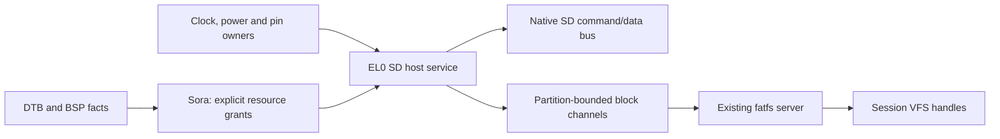

# Orange Pi 5 Plus: native SD card driver implementation map
<!-- j771 -->

Date: 2026-11-02. Author: KESTREL. Research and proposed implementation order;
no native SD driver, hardware initialization, or new authority policy lands here.
Baseline: `1fb2905f`. Register facts below use the RK3588 TRM V1.0, 2022-03-09.
Hardware observations below mean the **shipped DTB**, not measurements of live registers.

## 1. Target and completion criteria

The microSD slot is **SDMMC at `0xfe2c0000`, DesignWare MSHC**, with compatibles
`rockchip,rk3588-dw-mshc` and `rockchip,rk3288-dw-mshc`. It uses native SD commands.
The eMMC socket is a different controller: `0xfe2e0000`, `rockchip,rk3588-dwcmshc`,
with an SDHCI programming model. SDIO is a third instance at `0xfe2d0000`.
Do not build the slot driver by applying the eMMC register map to SDMMC. [T1, T2, D]

The useful baseline is SDSC/SDHC/SDXC memory cards, 512-byte block service,
1-bit identification followed by negotiated 4-bit operation, Default Speed and
then High Speed at 3.3 V, read/write/flush, bounded failures, removal/reinsertion,
and restart without stale handles reaching a replacement card. PIO is a viable
transfer implementation; DMA is a separate optimization and authority gate.
UHS SDR104, 1.8 V, tuning, SDUC, SDIO functions, eMMC, and SD Express need separate
gates. Their absence must be reported honestly, without preventing slower compatible
memory cards from working. A controller working with SDXC does not imply exFAT support.

Completion requires exact block hashes, filesystem persistence after reboot,
write-authority rejection, timeout/removal recovery, and a demonstrated containment
story. Enumeration or a FAT directory listing alone closes neither the writable
driver nor the isolation gate. This document proposes those gates; it does not
amend DESIGN/009 or claim that DMA containment is already available. — KESTREL

## 2. Source ledger and reproducibility

Local evidence is in `build/verification/j771/`: downloaded reference files,
`sources.sha256`, `local-sources.sha256`, layout-preserving PDF extractions,
the decompiled shipped DTB, and rendered pages checked for layout ambiguity.
Reference files are not added to Git. Linux is a behavioral cross-check; no Linux
implementation is copied into KUMO. The TRM and card specification govern hardware;
KUMO's design documents govern authority and recovery.

Key input identities: SDMMC chapter SHA-256
`42cf6e4b02c0ba8bec17ccd1f648c90d65cd7adde357ba582169394ea6cb165a`;
shipped DTB SHA-256
`0331f521a6f2512ab0a594bc2f76b99b4b79c890e90984071788c27b63757c86`.

| ID | Primary source / exact locator | Use and limits |
|---|---|---|
| T1 | `resources/rk3588-TRM-and-Datasheet-master/trm-part1/ch01-system-overview.txt`, address map and interrupt table | SDMMC/SDIO/eMMC bases; GIC INTID 235/236/237 |
| T2 | Same corpus, `trm-part2/ch03-mobile-storage-host-controller.txt`, printed pp. 578–639 | Slot host, FIFO, registers, commands, reset, error handling, voltage and phase sequencing |
| T3 | Same corpus, `trm-part2/ch04-emmc-host-controller.txt` | Distinguishes the eMMC SDHCI host; not the slot register model |
| T4 | `trm-part1/ch02-cru.txt`, base table p. 29; `CRU_SDMMC_CON0/1`; `SECURECRU_CLKSEL_CON03`, `SECURECRU_GATE_CON03` | Clock ownership, secure clock source, phase controls |
| T5 | `trm-part1/ch06-general-register-files-grf.txt`, `PMU1GRF_SD_DETECT_*`, `SYS_GRF_SOC_CON6/10/11`, GPIO4D IOMUX; `ch20-gpio.txt` | Detect, JTAG sharing, IO routing; shared register pages require an owner |
| T6 | `trm-part1/ch08-mmu600.txt`; `trm-part2/ch01-interconnect.txt` | MMU600 integration and SDMMC bus master; does not establish an SDMMC translation context |
| T7 | `trm-part1/ch13-sdmmc-buffer.txt`, p. 1371 | Separate 32×32 output FIFO, selectable onto SD pins; not the host's 256×32 FIFO or a general RAM bounce buffer |
| H | `resources/rk3588/RK3588 Hardware Design Guide-V1.0.pdf`, §2.3.1.1, printed pp. 61–62, PDF pp. 77–78 | SoC reference circuit, VCCIO2, pulls and pin sharing; **not** the Orange Pi schematic |
| P | Same TRM corpus, `power/Rockchip RK806 Datasheet V1.0 -20211020.txt`, interface, regulator and register chapters | PMIC control dependencies for BUCK8/PLDO5; live output settings must be read, not inferred from reset defaults |
| D | KUMO image `build/images/orange-pi-5-plus/EFI/KUMO/dtb/rockchip/rk3588-orangepi-5-plus.dtb` | Exact configured board topology, decoded as `kumo-shipped.dts`; not proof of live voltages or clock rates |
| L | [Linux source tree at `146cc263e457ff6055fe7829e4f4f4b0b5d5dd86`](https://github.com/torvalds/linux/tree/146cc263e457ff6055fe7829e4f4f4b0b5d5dd86) | Immutable comparison revision, files listed below |
| S | SDA, Physical Layer Simplified Specification **9.10**, 2023-12-01, §§4.2–4.3, 4.7, 4.17, 5.3, 5.8, 6.4 | Native card protocol, capacity, timing and optional cache; public simplified version omits some material |
| C1 | `resources/scsi/05-344r0.pdf`, T10/05-344 rev. 0 / proposed SBC-3 rev. 00, 2005; §4.10, §5.10, §5.18 | Block/cache semantics comparison; draft, not an SD command reference |
| C2 | `resources/scsi/SCSI-command-reference-manual.pdf`, Seagate **100293068 Rev. D**, December 2010, §§3.25, 3.53 | SCSI READ CAPACITY and SYNCHRONIZE CACHE comparison; disk-vendor manual, not slot hardware |

The TRM PDF originals are absent from the named corpus; its index records earlier
`pdftotext -layout` conversion and lossless chapter splitting. Preserve that limitation
when a table disagrees with hardware; obtain the original page rather than guessing.

S was obtained from a [mirror of the SDA-authored PDF](https://www.lishutong1024.cn/pdf/Part1PhysicalLayerSimplifiedSpecificationVer9.10Fin_20231201.pdf)
after the SDA download returned HTTP 403. SHA-256:
`9e243598ca9ed152da5a97ef612a253151f996b9f3cfb067867bd68369bf56df`.
The [SDA catalog](https://www.sdcard.org/downloads/pls/) identifies that revision.
This records authorship and retrieval provenance, not an authenticated SDA download.

Useful files under L (all downloaded and hashed locally):

- `arch/arm64/boot/dts/rockchip/rk3588-orangepi-5-plus.dts`, its included
  `rk3588-orangepi-5.dtsi`, and `rk3588-base.dtsi`.
- `Documentation/devicetree/bindings/mmc/rockchip-dw-mshc.yaml`.
- `drivers/mmc/host/dw_mmc.c`, `dw_mmc.h`, `dw_mmc-rockchip.c`.
- `drivers/mmc/core/sd.c`, `sd_ops.c`, `mmc_ops.c`, `block.c`;
  `include/linux/mmc/sd.h`, `mmc.h`.
- `drivers/clk/rockchip/clk-rk3588.c`.

Reproduce the extraction and inspect the relevant page, not only search hits:

```sh
pdftotext -layout 'resources/scsi/05-344r0.pdf' build/sbc3.txt
pdftotext -layout 'resources/rk3588/RK3588 Hardware Design Guide-V1.0.pdf' build/rk3588-hardware.txt
dtc -I dtb -O dts -o build/sd-board.dts build/images/orange-pi-5-plus/EFI/KUMO/dtb/rockchip/rk3588-orangepi-5-plus.dtb
pdftoppm -f 78 -l 78 -singlefile -png 'resources/rk3588/RK3588 Hardware Design Guide-V1.0.pdf' build/sd-reference
```

## 3. Board and resource inventory

The shipped DTB resolves the following. Compare any replacement DTB rather than
hardcoding its phandle numbers, and honor `status` and ancestor bus translations.
The modern L board DTS factors common wiring into `rk3588-orangepi-5.dtsi`.

| Resource | Configured value | Implementation consequence |
|---|---|---|
| Host register window | `0xfe2c0000`, length `0x4000` | DT aperture bounds the grant; TRM's 64 KiB system slot is not a reason to grant 64 KiB |
| IRQ | SPI **203**, level high; GIC INTID **235** | Apply the SPI-to-INTID `+32` once; parse the tree's four-cell GIC interrupt specifier |
| Host / card clocks | SCMI IDs **23** (`biu`, HCLK_SD) and **9** (`ciu`, CCLK_SD) | Firmware owns these secure clock controls; obtain rate/enable authority explicitly |
| SCMI transport | `arm,scmi-smc`, function `0x82000010`, shared memory `0x0010f000` / `0x100` bytes, clock protocol `0x14` | DT description only; prove callable firmware behavior and exclusive mailbox ownership |
| Drive / sample clocks | CRU IDs **685/686**, names `ciu-drive`, `ciu-sample` | Phase controls are separate from host `CLKDIV` |
| Power domain | SDMMC, DT ID **40** | Keep powered and clocked throughout register access and pending transfers |
| Data / command / clock | GPIO4_D0–D3, GPIO4_D4, GPIO4_D5; mux function 1 | 4-bit data bus; validate IO mode and pulls, including JTAG auto-selection |
| Detect | GPIO0_A4, active low | Tree selects SDMMC detect mux too; choose and prove one detection path |
| Socket write protect | `disable-wp` | No usable mechanical WP input described; still honor card CSD/status write protection and channel authority |
| Card supply `vmmc` | RK806 `dcdc-reg8`, `vcc_3v3_s3`, 3.3 V, always-on | Shared with eMMC; do not toggle the rail as an individual-card reset |
| IO supply `vqmmc` | RK806 `pldo-reg5`, `vccio_sd_s0`, 1.8–3.3 V, always-on | VDD and signal voltage differ; inspect actual state before changing IO mode |
| Advertised modes | 4-bit, High Speed, SDR104, max-frequency **150 MHz**, no MMC/SDIO | Limits are board ceilings, not permission to start at 150 MHz or use 1.8 V immediately |
| DMA topology | No `iommus`, `iommu-map`, external `dmas`, or `dma-coherent` property on this host | No established DeviceCtx or coherent-memory contract follows from this node |

**Still needed before writes to the host:** exact PCB revision/schematic, actual
clock rates, callable firmware SCMI transport and clock permissions, live domain
state, regulator/IO voltage state, and bootloader handoff state. The SoC guide is
insufficient to assert board power-cycle capability. The tree's always-on, shared
card rail makes an independent software power cycle unproven. — KESTREL

Clock controls: CRU base is `0xfd7c0000`; SD phase words are `+0x0c30/+0x0c34`.
The source mux/divider and gates are in **SECURECRU** at `0xfd7d0000`,
`+0x030c` and `+0x080c`. Do not map that shared secure page into the card driver.
Linux's Rockchip integration divides the CIU clock by **2** before the host's
divider: `f_card = f_ciu/2` for divider zero, otherwise `f_ciu/(4*divider)`.
Reconcile the exact firmware clock meaning before computing a divider; using the
generic DW formula with the wrong input rate can double the card clock. [T4, L]
The nonzero host divider is eight bits: round up to stay below the requested rate,
and reject an unachievable rate rather than clamp and overclock identification.
The inherited parent may need a firmware rate change to reach ≤400 kHz.

The shipped pin groups use pull-up/drive-level-2 for CLK/CMD/D0–D3; the generic
Rockchip hardware guide recommends a clock pull-down. Preserve this distinction:
validate the board's actual circuit and selected mode before adopting either policy.

Additional control dependencies, from T5 and D:

- BUS_IOC at `0xfd5f8000`, GPIO4D mux low/high `+0x0098/+0x009c`, routes
  data/command/clock to function 1. GPIO4_D2/D3 share JTAG; inspect
  SYS_GRF_SOC_CON6 bit 14 and SOC_CON11's detect window before changing routing.
- VCCIO2_IOC at `0xfd5fb000`: GPIO4D drive low/high `+0x0098/+0x009c`,
  pulls `+0x014c`, input enable `+0x01bc`, Schmitt control `+0x024c`.
  PMU1_IOC at `0xfd5f0000`, GPIO0A mux high `+0x0004`, contains detect pin A4.
  These are shared pages, not additional raw driver grants.
- RK806 is on **SPI2**, controller `0xfeb20000`, chip select 0, DT maximum
  1 MHz. Voltage control therefore needs the PMIC/SPI owner or an established
  firmware interface; it is not an I2C transaction. BUCK8 and PLDO5 sequencing,
  voltage selection, ramp and readback belong to that owner. P is available locally.
- No SCMI client implementation was found in the current KUMO library/Sora/HAL/kernel
  Rust sources. The DT's SMC ID is not an EL0 capability. A generic bounded firmware
  transport and serialized mailbox ownership may be prerequisite work, subject to
  the existing kernel/HAL boundary; do not embed SD clock policy in the kernel.

## 4. Authority, handoff and process boundaries



Keep card state, controller programming, retries and block service in userspace.
Kernel code names no SD registers. BSP/DT discovery supplies board facts; the pure
host crate supplies the IP register model. A service owns its Interrupt handle,
device MMIO authority, control channel and CPU buffers. Clock/PMIC/GRF changes go
through their owners with bounded operations; a masked write does not make a shared
page safe to grant. Read DESIGN/017 for that BSP/DT precedence.

DESIGN/009 requires DMA only into VMOs mapped in the assigned DeviceCtx. Neither
the shipped node nor the MMU600 chapter establishes a translated SDMMC stream.
An interconnect master identifier is **not** an SMMU stream ID. Prove the complete
path or record that this host lacks a usable translation path; never invent a SID.

**PIO does not by itself solve containment.** Full writable host MMIO also permits
programming DMA registers and enabling IDMAC. A cooperative driver leaving DMA off
is not enforcement. Before granting that window, resolve one of these explicitly:
prove hardware containment; prove an independently enforced DMA-disable mechanism;
or obtain a documented architecture decision about a trusted hardware owner and a
narrow broker interface. The last option changes the trust boundary and needs its
own review; it is not an exception silently granted by this plan. Read-only metadata
discovery and register snapshots can precede that decision. — KESTREL

UEFI/SPL may leave a card selected, clocks gated, signaling at 1.8 V, IDMAC active,
or an existing descriptor address installed. Take exclusive ownership and establish
quiescence before resetting or reusing memory. Do not treat `ExitBootServices` as a
host reset. Capture safe registers first; do not read the FIFO during inventory.
A firmware-retained baseline is a measured bring-up dependency, not a completed
cold-init implementation. For a warm 1.8 V card, establish a valid return-to-3.3 V
sequence before starting the baseline enumeration; CMD0 alone is not a voltage reset.

## 5. Host register map and execution rules

All offsets below are **32-bit accesses** relative to SDMMC, from T2 §§3.4–3.6,
printed pp. 599–629. Validate `VERID/HCON` on hardware rather than relying on reset
values. Use the existing Device-memory mapping/barrier conventions; normal Rust
loads, a volatile qualifier alone, and CPU compiler ordering are not a complete
device synchronization contract.

| Offset | Register(s) | Required behavior |
|---|---|---|
| `00` | CTRL | Controller/FIFO/DMA resets bits 0/1/2 self-clear; interrupt enable bit 4, DMA enable bit 5, internal-DMAC selection bit 25 |
| `04` | PWREN | Host power output; does not establish actual RK806 rail control |
| `08/0c/10` | CLKDIV / CLKSRC / CLKENA | Stop → latch → change divider/source → latch → enable → latch; use clock-update commands |
| `14/18` | TMOUT / CTYPE | Response/data timeouts depend on card clock; CTYPE bit 0 selects four data lines |
| `1c/20` | BLKSIZ / BYTCNT | Exact block length and finite total bytes; zero byte count is open-ended, avoid initially |
| `24/28/2c` | INTMASK / CMDARG / CMD | Clear stale status, program transfer fields, argument, then command |
| `30/34/38/3c` | RESP0–3 | Decode short/long responses deliberately; test normalization with known CID/CSD vectors |
| `40/44` | MINTSTS / RINTSTS | Masked/raw status; RINTSTS is write-one-to-clear, snapshot errors before clearing |
| `48/4c` | STATUS / FIFOTH | Busy bit 9, FIFO count bits 29:17; FIFO is **256 × 32-bit words**; thresholds count words |
| `50/54` | CDETECT / WRTPRT | Detect low means present; board disables socket WP; card status remains relevant |
| `5c/60/64` | TCBCNT / TBBCNT / DEBNCE | Diagnose card-vs-host byte counts and detect debounce |
| `6c/70/74` | VERID / HCON / UHSREG | TRM reset version `0x5342270a`, HCON `0x04c434c1`; probe live values; baseline non-DDR |
| `80/84/88` | BMOD / PLDMND / DBADDR | IDMAC bus mode, resume demand, descriptor base; unavailable to an uncontained driver |
| `8c/90/94/98` | IDSTS / IDINTEN / DSCADDR / BUFADDR | DMA completion/errors and diagnostic addresses; do not confuse with a 64-bit DW register layout |
| `100` | CARDTHRCTL | Read threshold can reserve one full block of FIFO space; 512-byte block fits a 1024-byte FIFO |
| `120/200` | RDYINT_GEN / FIFO | Optional ready interrupt; data FIFO port at `0x200`, not a RAM array to index |

Command construction: opcode bits 5:0; response expected/long/CRC bits 6/7/8;
data expected bit 9; write bit 10; stream bit 11 stays clear; auto-stop bit 12;
wait-previous-data bit 13; stop/abort bit 14; send-init bit 15; clock-update-only
bit 21; hold-register use bit 29; start bit 31. Honor the implemented hold register
and Rockchip phase configuration. Once START is set, do not rewrite the transferred
command, timeout, width, count or clock fields until hardware clears START.
**START clearing means command accepted, not card command completed.** [T2 pp. 579–580, 605–608]

Raw interrupt bits: detect 0; response error 1; command done 2; data over 3;
TX/RX FIFO request 4/5; response/data CRC 6/7; response/data timeout 8/9;
host starvation/voltage-switch 10; FIFO over/underrun 11; hardware-locked error 12;
start/end-bit errors 13/15; auto-command done 14. Bit meanings depend on mode.
Enable with INTMASK bits set to one; do not invert the mask because of ambiguous
prose elsewhere in the table. [T2 pp. 604–610]

Use one request state machine: prepare → issue → response → data → stop, if needed
→ card-ready → complete. Interrupts and polling must feed the same transitions.
Any error dominates simultaneous success bits. Check response status separately
from host CRC/timeout status. Clock-update-only commands clear START without a
command-done IRQ; bound that wait and any HLE retry. [T2 pp. 621–629]
Use monotonic software deadlines as well as hardware TMOUT, including separate
response, data, programming, reset and initialization budgets. A slow clock changes
hardware timeout coverage. Expected legacy CMD8 timeout must be acknowledged before
the next command; it must not poison ACMD41 or mask a real response failure.

PIO reads must drain the FIFO tail after DTO, even when the RX watermark is not
reached. PIO writes put exactly the remaining words into available FIFO space,
then wait for data completion and card programming to finish. Small SCR/status/
switch transfers are data commands too. Pad host accesses to FIFO word width while
preserving the exact card byte count; never expose padding to clients.

## 6. Native SD protocol and geometry

Implement the following using T2's command/data engine and the card state model.
Linux core `sd.c`/`sd_ops.c`/`mmc_ops.c` and its command headers provide an independent
execution/response cross-check. Each ACMD attempt includes a fresh CMD55; validate
APP_CMD acceptance rather than treating command submission as acceptance.

| Phase | Commands / response | Validation and state |
|---|---|---|
| Idle | CMD0, no response, host sends initialization clocks | 1-bit, identification clock ≤400 kHz, known 3.3 V signaling |
| Interface condition | CMD8 argument `0x1aa`, R7 | Echo/voltage check; distinguish legacy SDSC timeout from a mismatched response or absent card |
| Operating conditions | CMD55 + ACMD41, R1 then R3 | Supported voltage window; HCS for the v2 path; S18R clear for baseline; bounded repeated pairs until ready |
| Identify | CMD2 R2; CMD3 R6 | Save CID, validate RCA/status; use the returned RCA, not a fixed value |
| Geometry | CMD9 R2 | Decode CSD structure, capacity, transfer rate and protection; reject unsupported encodings |
| Select | CMD7 R1b; CMD13 R1 | Wait for busy release and a valid transfer state |
| Block length | CMD16 R1 where required for SDSC | Set 512 bytes; SDHC/SDXC block-addressing is already fixed to 512 bytes |
| Configuration | CMD55 + ACMD51, 8-byte SCR | Parse bus-width/version support and payload byte order |
| Four lines | CMD55 + ACMD6 argument 2, R1 | Change host CTYPE only after card accepts; retain proven 1-bit fallback |
| High Speed | CMD6 check/switch, 64-byte switch-status data | Different command from ACMD6; verify support/selection before raising clock, ≤50 MHz |
| Read | CMD17 single / CMD18 multiple, R1 + data | Explicit finite size, correct address units, exact received bytes, CRC checks |
| Write | CMD24 single / CMD25 multiple, R1 + data | Explicit write authority, card-status checks, busy completion; uncertain failures are not blindly replayed |
| Stop/status | CMD12 R1b; CMD13 R1 | Abort uses stop flag and can bypass wait-previous-data; wait for safe transfer state |

S §§4.2.3 and 5.3 give the capacity rules: SDSC addresses bytes; SDHC/SDXC address
512-byte blocks. SDSC byte capacity is `(C_SIZE+1) * 2^(C_SIZE_MULT+2) * 2^READ_BL_LEN`;
v2 CSD byte capacity is `(C_SIZE+1) * 512 KiB`. Use checked `u64` arithmetic and
validate the 32-bit command argument. ACMD41 readiness has inverted-looking semantics:
OCR bit 31 **one** means initialization finished. Use a deadline exceeding one second
from the first voltage-bearing request. R3 has no valid response CRC. Reject unsupported
CSD structures instead of truncating larger cards. [S pp. 43–45, 226–235]

Do not derive sectors from a SCSI READ CAPACITY response: native SD has none. Keep
raw CID/CSD/OCR/SCR plus normalized geometry in a card-generation record. Validate
all `lba + count`, partition-offset additions and byte multiplications before issuing
hardware work. At the boundary, permit the final legal sector and reject the next;
do not confuse a last-LBA value with a block count. Test response-register bit alignment
independently of payload byte order and little-endian block IPC. The DW Linux
cross-check normalizes long responses as RESP3, RESP2, RESP1, RESP0 (most-significant
word first), and short responses from RESP0; test the hardware result before reuse.

Baseline flush drains the server queue, finishes card programming, and verifies
ready/transfer status; it is not merely FIFO-empty or DTO. Do not enable optional
write cache, command queueing or maintenance in the baseline. Verify inherited state
before promising persistence. If cache is enabled, S §4.17 / §5.8 requires its native
extension-register flush and power-off handling; CMD13 alone is insufficient.
ACMD23 is a pre-erase hint, not a flush operation. [S pp. 179–180, 268–270; L core]

Optional UHS needs a separate host sequence from normal commands: negotiate S18R/S18A,
issue CMD11 with CMD bit 28, observe voltage-switch status and line transitions,
stop the clock, change the IO supply through its owner, observe settling times,
restart and verify the lines high. Prove failure recovery by a genuine card power
cycle; the shared always-on supply makes that a board-level prerequisite. CMD0
is not a substitute. T2's voltage prose sometimes numbers the 48-bit wire packet,
not CMDARG: CMD8 VHS is argument bits 11:8, and ACMD41 HCS/S18R are argument bits
30/24. Do not copy the wire positions into CMDARG. [T2 pp. 630–634]

Tuning uses CMD19's known data pattern, successful CRC/data comparison across a
sample-phase sweep, and selection inside a stable valid window, including phase
wraparound. T2 §3.6.7 requires clock-generation initialization while changing phase/
delay controls. Record both drive and sample settings, retrigger when required by
mode/rate changes, and retain a tested slower fallback. [T2 pp. 636–638; L Rockchip host]

## 7. DMA investigation and final transfer design

There is a genuine documentation conflict. T2's HCON table labels bits 17:16 = 0
as no DMA and 1 as internal DMA. Linux `dw_mci_init_dma` explicitly corrects this:
0 selects internal DMA, 1 DW external DMA, 2 generic external DMA, 3 PIO only.
The TRM reset value has that field zero. Linux also checks HCON bit 27 for 64-bit
IDMAC addressing, whereas the TRM calls bits 31:27 reserved. Capture the real HCON
and version; reconcile before choosing a descriptor layout. **Do not conclude
that DMA is absent from the ambiguous zero encoding.** [T2 pp. 613–614; L host]

T2 describes 32-bit-addressed IDMAC registers and descriptors. For that confirmed
mode the intended path is a bounded, driver-owned bounce-buffer pool plus descriptor
memory, all mapped in the proven DeviceCtx, with every device-visible span fitting
below 4 GiB. Check the whole range, not only its first address. Never truncate an
IOVA or CPU physical address. A pool below 4 GiB provides addressability, not isolation.
If live capabilities differ, implement and test the alternate format separately.

The 32-bit chained descriptor has four words: control/status, buffer sizes,
buffer address, next-descriptor address. Relevant control bits are OWN 31, card
error 30, chain 4, first 3, last 2, disable-interrupt 1. Use ≤4096 data bytes per
chained entry, validate alignment and all links, terminate the final entry, and
keep descriptors inaccessible to clients. This is **IDMAC**, not SDHCI ADMA2. [T2 §3.3.1; L host]

Submission/completion obligations, after the authority gate is closed:

1. Acquire stable VMO mappings, pins and device addresses for descriptors and data.
   Validate count, address width, direction and channel access before publishing OWN.
2. Perform required cache maintenance on data and descriptor ranges, publish with
   the architecture's DMA ordering, then program the host. No `dma-coherent` claim
   has been established. Determine cache-line boundaries and avoid unsafe cache aliases.
3. Collect host **and** DMA completion/error status. Data CRC, remaining bytes,
   descriptor ownership and card programming status all affect success; one DMA IRQ
   or DTO alone is insufficient.
4. On completion, establish device quiescence, apply device-to-CPU ordering/cache
   maintenance, then expose data. Keep mappings live until no fetch/write can occur.
5. On timeout/removal/death, mask sources, stop the engine and transfer, complete
   bounded reset/drain, and only then revoke/recycle memory. If quiescence cannot be
   proved, quarantine buffers and take the device offline; do not reuse their pages.

T2 §3.6.1 explicitly says controller reset does not clear FIFO, and resetting DMA
can terminate pending bus traffic abruptly. A self-cleared reset bit alone is not
a proof that a dead process's memory is safe to reclaim. Device fault isolation and
restart need a proof independently of successful read throughput. — KESTREL

## 8. KUMO integration and reuse

The current project already has USB BOT/SCSI reads, writes, flush and removable
FAT32 media. PLAN/008's older broad statements about absent storage are historical,
not a reason to rebuild completed USB work. DESIGN/010's j514 correction permits
read/write FAT on removable SD/USB; RedoxFS remains the native-root objective.

| Existing / proposed location | Work and boundary |
|---|---|
| `lib/kumo-fdt/src/lib.rs`, `lib/kumo-bsp/src/lib.rs` | Reuse parsing and board identity. Proposed typed SD discovery belongs with the host crate, as xHCI discovery does; fixed board fallbacks follow BSP policy |
| Proposed `lib/kumo-sdmmc/` | `no_std`, allocation-free command types, response/CSD/SCR decoding, checked geometry, register plans, request/deadline transitions, DT discovery; fake register/clock adapters for meaningful host tests |
| Proposed `userland/servers/drv-sdmmc/` | EL0 host owner, granted MMIO/IRQ/control channels, safe handoff, bounded wait loop, block backend; MMIO ownership waits on §4 |
| `userland/sora/src/main.rs` | Bootstrap grants and service launch/restart, storage control registration, removal and mount lifecycle; no SD register programming |
| `userland/servers/drv-blk/src/lib.rs` | Reuse READ/WRITE/FLUSH wire codec and `BlockAccess`, `MediaReady`; no SCSI envelope is necessary |
| `lib/kumo-gpt/src/lib.rs` | Reuse validated GPT, MBR and superfloppy geometry; transport-independent parsing already exists |
| `lib/kumo-fatfs/`, `userland/servers/fatfs/` | Reuse FAT probing and block-backed filesystem service; keep raw-device and partition-relative LBAs distinct |
| `lib/kumo-usb-storage/`, `userland/servers/drv-xhci/` | Leave BOT/SCSI transport here. Factor only demonstrably shared partition/media logic when the SD consumer needs it |
| `Cargo.toml`, `xtask/src/`, image/initrd assembly | Register/build/stage the new library and server at the implementation gate; preserve all existing board images |

The block request is **11 bytes**: command `u8`, LBA `u64 LE`, count `u16 LE`;
operations are 0 read, 1 write, 2 flush. Responses carry a status byte followed by
read data. Existing errors include bad LBA/length, read-only and I/O failure.
`CONTROL_MEDIA_READY` is a 25-byte volume announcement; `CONTROL_CONNECT` transfers
a fresh client channel with explicit read-only/read-write access. Clamp operations
to actual IPC capacity as well as the protocol count field. A partition channel's
LBA zero is that partition's start, and never grants disk-wide writes.

There is a concrete integration debt: Sora stores **three xHCI storage controls**,
and `/dev/diskNs1` indexes controllers. `media_offered` indexes that fixed array;
it also calls the source USB in diagnostics. SD cannot borrow an xHCI index.
Introduce bounded transport-independent registration/device identity before mounting
SD, retaining existing USB names or an explicit migration. The current one-mounted-
volume policy can remain. Current `s1` labels the offered volume and is not sufficient
for arbitrary multiple-partition enumeration; do not pretend to expose all partitions.

Removal must close/revoke channels for that **card generation**, tear down the FAT
instance and mount, and preserve uncertain-write diagnostics. Reinsertion creates
new channels and card identity; an old file handle must never start addressing the
replacement card. A remount is not a substitute for a flush. Keep durable filesystem
state on media, with a reconstructible launch recipe as DESIGN/002 requires.

SCSI sources supply comparison semantics, not native commands:

| Concern | Existing USB/SCSI path | Native SD path |
|---|---|---|
| Capacity | READ CAPACITY(10), last LBA + block length | OCR/CSD decode and checked addressing units |
| Data | READ(10)/WRITE(10) inside BOT CBW/CSW | CMD17/18 and CMD24/25 through SDMMC |
| Flush | SYNCHRONIZE CACHE(10) | Native programming completion and, if enabled, SD cache extension handling |
| Errors | Transport status and SCSI status/sense | Host status, SD response status, detect and current card state |

C1 is an early SBC-3 draft. C2 is a Seagate manual. The UAS file is rev. 1, 2008,
despite misleading embedded PDF metadata naming ATA; its actual title page identifies
UAS. PQI-2 is a PCIe queue transport, and ECMA-111 / SCSI-2 are older SCSI material.
None replaces the native SD physical-layer specification. An SD card in a USB reader
would use the existing USB/SCSI path; that is a different hardware target.

## 9. Ordered slices and acceptance proofs

Every slice follows `default.p`: governing docs, meaningful touched-crate tests,
kernel/ABI tests, required images, QEMU smoke, signed journal and isolated inverse.
Do not combine the ladder into one driver drop. QEMU virt smoke proves boot regressions,
not RK3588 register timing or real card data; use a fake host for state-machine tests
and metal for every claimed physical behavior.

| Slice | Smallest deliverable | Proof that closes its gate |
|---|---|---|
| SD0 | Pure typed discovery and source fixture; no MMIO | Enabled slot has correct translated window/INTID/clocks/supplies; eMMC/SDIO/disabled/malformed nodes rejected; no fabricated DeviceCtx |
| SD1 | Read-only safe-register snapshot on metal | Version/HCON, clock/power/IO dependencies and handoff state logged with image/DTB hashes; no FIFO or state-changing reads; no resets or card commands |
| SD2 | Resolve writable MMIO authority and platform controls | Explicit containment/trust decision; clock rate query/set, supply/IO/pin ownership and quiesce/reset protocol proven; fail closed when unavailable |
| SD3 | Pure protocol/geometry implementation | Known and malformed CSD/SCR/response vectors, SDSC byte-address overflow, HC/XC final-sector bounds, R3 CRC exception, deadlines and command ordering |
| SD4 | 1-bit ≤400 kHz PIO initialization | Live CID/CSD/OCR/RCA match a host-side identity/capacity reference; no-card and incompatible-card exits are bounded |
| SD5 | PIO single-block reads | Known fixture LBA hashes plus final legal/out-of-range checks; FIFO-tail test with sub-sector protocol data; injected CRC/timeout never returns success |
| SD6 | IRQ-driven request/recovery loop | SPI 203 / INTID 235 correctly bound; masked/stray/late/coalesced IRQs, simultaneous error+done, removal during transfer and retry budgets proven |
| SD7 | Shared block/media integration, read-only mount | Distinct SD and USB identities coexist; GPT/MBR/superfloppy FAT32 fixtures read through existing fatfs; unmount/removal revokes stale-generation clients |
| SD8 | Authorized PIO single-block writes and real flush | Reserved disposable extent, original/guard hashes, write/readback, flush, reboot/removal persistence and host reread; read-only alias cannot write; no automatic formatting |
| SD9 | Multi-block and negotiated 4-bit / High Speed, split further as needed | CMD12/auto-stop and partial failure validated, then exact hashes across sizes/alignment at each negotiated mode; 1-bit/slow fallback retained |
| SD10 | IDMAC only after §4 containment proof | Descriptor/address/cache tests, PIO-vs-DMA byte equivalence, deliberate mapping fault, reset/removal/death during DMA, and no writes to unmapped/guard pages |
| SD11 | Optional UHS/1.8 V and tuning | CMD11 line/voltage sequencing, regulator/IO agreement, tuning window with wraparound, fallback and failed-switch recovery; board/card/temperature coverage |
| SD12 | Closure and operational coverage | Cold/warm boot, repeated insert/remove, restart, full fixture matrix, bounded latency and throughput records; baseline and optional modes reported separately |

SD3 pure work may proceed while SD2 is unresolved. No writable host grant or IDMAC
experiment bypasses SD2. SD0 is the next implementation slice; this research map is
not its acceptance proof. The graphics GL2 work remains a separate workstream.

## 10. Test fixture and failure matrix

Prepare a disposable card image on the host, record CID/capacity plus the full-image
hash, and reserve a clearly bounded write-test extent outside partition metadata.
Record hashes for LBA0, the partition header/BPB, known data, final legal sector and
neighbor guard sectors. Save the original test extent for restoration. Initial probes
read only; never infer permission to write from a detected FAT signature.

| Dimension | Required cases |
|---|---|
| Geometry | Legacy SDSC fixture and v2 SDHC/SDXC; zero/max/overflow count; last sector; partition+disk bounds; unknown CSD rejected |
| Protocol | CMD8 mismatch vs expected legacy timeout; ACMD41 never ready; RCA/status errors; R1b busy; locked/protected card; 8/64/512-byte data payloads |
| Controller | Stuck START/reset/busy; HLE; CRC/timeout/FIFO errors; DTO with residual FIFO; counts mismatch; missing/late/duplicate interrupt |
| Media | No card; insert bounce; remove idle/read/write/busy; different CID on reinsertion; stale handle; server death and restart |
| Persistence | Write, flush, readback; independent reboot and host verification; flush failure remains failure; no success on uncertain partial write |
| Authority | Read-only block alias rejects writes before I/O; client cannot select physical LBAs/MMIO/DMA addresses; uncontained DMA never enabled |
| Filesystem | GPT FAT32, MBR FAT32, FAT32 superfloppy, corrupt metadata, unsupported exFAT reported separately from block I/O |
| Performance | Same hash workload at identification/Default/High Speed; PIO CPU use; multi-block throughput; DMA comparison only after containment |

Log controller version, card identity/generation, negotiated voltage/width/rate,
request LBA/count, phase, raw host/card/DMA status, bytes completed, timeout/retry
count and final result. Keep the normal boot concise; put full snapshots in the
proof transcript. Never log card contents or filesystem data as a substitute for
hash-based comparison.

## 11. Unresolved gates, with the evidence each needs

1. **Physical board wiring:** obtain the Orange Pi 5 Plus schematic matching the
   PCB revision; verify detect, RK806 outputs, VCCIO2 and any socket power switch.
   DT plus the generic Rockchip circuit does not prove a private card power switch.
2. **Firmware control:** prove the DT-described SCMI SMC/mailbox transport and accepted
   clock IDs/rates, secure reset controls, retained power and voltage state. Capture
   a cold and warm handoff; account for another device sharing each supply/page.
3. **DMA authority:** trace SDMMC through the interconnect and establish an enforceable
   hardware boundary or reviewed trust decision. Absence of a DT binding is a gap,
   not proof either of containment or its physical impossibility.
4. **IP interpretation:** measure VERID/HCON, FIFO width/depth, address mode and command
   response layout; reconcile the DMA table conflict with original TRM pages and
   controlled hardware results before choosing a descriptor format.
5. **Persistence:** prove cache-disabled baseline after handoff or implement/verify
   the supported native cache controls. Establish what flush guarantees and what
   a timeout leaves unknown; do not promise filesystem power-loss atomicity.
6. **Removal and naming:** extend Sora's finite storage registry without aliasing USB
   identities, and define generation revocation before exposing a writable mount.

These are specific implementation prerequisites, not evidence that the whole task
is blocked: SD0/SD3 and safe SD1 inventory can close independently. — KESTREL
